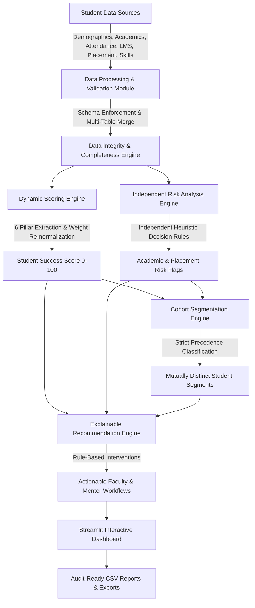

# 🎓 EduPredict AI — Student Analytics & Success Platform

> **byteXL HacXLerate 2026 | Problem Statement 4 by KPMG in India**  
> *Smarter Insights. Transparent Evaluation. Actionable Student Support.*

---

## 📌 Executive Summary

**EduPredict AI** is a comprehensive, production-grade diagnostic analytics platform designed for colleges, faculty advisors, and placement departments. Rather than acting as a black-box machine learning system, EduPredict AI integrates multi-dimensional student data—**Academics, Attendance, LMS activity, Placement readiness, Technical skills, and Faculty/Mentor feedback**—to calculate an **auditable Student Success Score (0–100)**, identify students requiring targeted intervention, provide the exact contributing factors behind every flag, and recommend concrete, explainable remedial actions.

---

## 🏗️ System Architecture



---

## 🌟 Key Features

1. **Institutional Role-Based Authentication & User Login**
   - Secure login screen with role-based access for Deans, Academic Advisors, Placement Officers (TPOs), and Department Heads (HODs).
   - Sidebar user profile badge and one-click session sign out.
   - Quick 1-click demo login buttons for hackathon judges with pre-configured accounts:
     * **Dean / Administrator**: `admin` / `admin@2026`
     * **Academic Advisor**: `advisor` / `advisor@2026`
     * **Placement Officer (TPO)**: `tpo` / `tpo@2026`
     * **Department Head (HOD)**: `hod` / `hod@2026`

2. **Executive Student Success Dashboard**
   - KPI metrics: Total cohort, Average Success Score, Academic Support Needed, Placement Support Needed, and Average Attendance & CGPA.
   - Interactive Plotly visualizations: Score distribution histograms, Academic vs. Placement quadrant scatter plots with benchmark lines, Departmental performance comparisons, and Cohort segmentation donut charts.
   - Automated real-time diagnostic insight banners synthesizing cohort strengths and bottlenecks.

3. **Data Integration & Quality Audit Engine**
   - Single unified CSV upload or multi-table departmental uploads joined on `student_id`.
   - Schema validation against data types, range bounds (e.g. CGPA 0–10, attendance 0–100%), and required identifiers.
   - Duplicate ID detection, missing-value summaries, and row-level data completeness percentages.
   - **Zero-filling prohibition**: Missing data is never silently replaced with zero.

3. **Transparent Student Success Score & Dynamic Weight Re-normalization**
   - 6 Core Performance Pillars:
     * **Academic Performance (25%)**: CGPA (70%) + Internal Tests (30%) − Backlog penalty (5 pts/backlog).
     * **Attendance (20%)**: Classroom Attendance (70%) + Lab Attendance (30%).
     * **LMS & Digital Learning (15%)**: Assignment completion (70%) + Video lecture watching (30%).
     * **Placement Readiness (20%)**: Quantitative Aptitude (50%) + Mock Interview Score (50%).
     * **Technical Skills Assessment (10%)**: Coding score (60%) + Technical MCQ (40%) + Certified Skills bonus.
     * **Engagement & Feedback (10%)**: Mentor rating (50%) + Club participation (25%) + Sentiment (25%).
   - **Dynamic Weight Re-normalization**: When an indicator is missing, weights of valid indicators are re-normalized so they sum to 100%. If no indicators are present, returns `Unavailable` (`NaN`), never zero!

4. **Independent Academic & Placement Risk Evaluation**
   - Evaluates Academic Risk and Placement Risk independently using configurable thresholds.
   - Transparent statuses: `On track`, `Needs review`, `Support recommended`, `Insufficient data`.
   - Explains the exact contributing factors behind every support flag (e.g., *CGPA 5.2 < 6.0 cutoff; 2 backlogs recorded*).

5. **Student Cohort Segmentation with Deterministic Precedence**
   - Strict hierarchical classification to avoid ambiguous overlapping groups:
     1. `Insufficient data` (<35% completeness or score unavailable)
     2. `Multiple support needs` (both academic & placement support flagged)
     3. `Low attendance, reasonable academics` (attendance < 75%, CGPA ≥ 7.0)
     4. `Low academics, adequate attendance` (CGPA < 6.0 or backlogs ≥ 2, attendance ≥ 75%)
     5. `Strong academics, low placement readiness` (CGPA ≥ 7.5, placement < 60%)
     6. `Strong performance across available indicators` (high score across all dimensions)
     7. `Moderate / Consistent progress` (balanced middle)

6. **Explainable Rule-Based Interventions**
   - Tailored practical recommendations: remedial tutoring, advisor attendance check-ins, LMS assignment milestone plans, quantitative aptitude bootcamps, curated DSA coding tracks, and mock interview coaching.
   - Clear trigger reasons citing actual student metric values—zero LLM fabrication.

7. **Configurable Weights & Thresholds**
   - Real-time sliders allowing department heads and faculty to customize scoring weights and decision thresholds on the fly.

8. **Audit-Ready Reports & Exports**
   - Instant downloadable CSV files for: Scored Cohorts, Filtered Academic Support Rosters, Filtered Placement Support Rosters, and Raw Filtered Data.

---

## 📐 Scoring Formula & Mathematical Documentation

For student $i$ with set of available pillars $P_{valid} \subseteq \{1, \dots, 6\}$:

$$\text{Effective Weight } w_k' = \frac{w_k}{\sum_{j \in P_{valid}} w_j} \quad \forall k \in P_{valid}$$

$$\text{Student Success Score } S_i = \sum_{k \in P_{valid}} \left( \text{Pillar}_k \times w_k' \right)$$

$$\text{Completeness } C_i = \frac{|P_{valid}|}{6} \times 100\%$$

If $|P_{valid}| = 0$, $S_i = \text{NaN}$ *(Unavailable)*.

---

## 💻 Installation & Windows Setup

### Prerequisites
- Python 3.10+ (tested on Python 3.14 on Windows)
- PowerShell or Windows Command Prompt

### Step-by-Step Setup Commands (PowerShell)

```powershell
# 1. Clone or navigate to the project directory
cd "c:\Users\ASUS\OneDrive\Desktop\byte xl project"

# 2. Create and activate a Python virtual environment (optional but recommended)
python -m venv venv
.\venv\Scripts\Activate.ps1

# 3. Install dependencies
python -m pip install -r requirements.txt

# 4. Run automated test suite
python -m pytest tests -v

# 5. Launch the Streamlit application
python -m streamlit run app.py
```

The application will automatically open in your default browser at `http://localhost:8501`.

---

## 🧪 Automated Testing

The project includes unit tests covering data validation, missing indicators, score boundaries, weight re-normalization, risk classification, segmentation precedence, and recommendations:

```powershell
python -m pytest tests -v
```

Tests verify:
- ✅ Handling of complete and incomplete student records
- ✅ Correct dynamic weight re-normalization when indicators are missing
- ✅ Graceful return of `NaN` (unavailable) when zero valid indicators exist
- ✅ Enforcement of score bounds between $0.0$ and $100.0$
- ✅ Range validation and duplicate ID detection
- ✅ Precedence hierarchy in student segmentation
- ✅ Independent academic vs placement risk evaluation
- ✅ Accuracy of explainable recommendation triggers

---

## 📊 Sample Datasets & Templates

Located in `data/templates/`:
- `unified_student_dataset_template.csv`: Full sample dataset containing 100 fictional students with realistic distributions and targeted edge cases.
- `1_student_demographics_template.csv`: Demographics table (`student_id`, `name`, `department`, `semester`, `gender`).
- `2_academics_template.csv`: Academic records (`cgpa`, `backlogs`, `internal_test_pct`).
- `3_attendance_template.csv`: Attendance records (`attendance_pct`, `lab_attendance_pct`).
- `4_lms_activity_template.csv`: LMS interactions (`lms_assignment_completion_pct`, `lms_video_watch_pct`, logins).
- `5_placement_readiness_template.csv`: Placement assessments (`aptitude_score`, `mock_interview_score`).
- `6_skills_assessment_template.csv`: Skills evaluations (`coding_score`, `technical_mcq_score`, certifications).
- `7_engagement_feedback_template.csv`: Mentorship and feedback ratings.

---

## ⚖️ Ethical Guidelines & Responsible AI Disclaimer

1. **Advisory Prototype Only**: The Student Success Score is an exploratory diagnostic indicator built for hackathon demonstration. It is **not** a validated statistical predictive model of academic failure or job placement outcomes.
2. **Human-in-the-Loop Requirement**: High-stakes decisions (e.g. examination eligibility, placement shortlisting, academic warnings) must never be automated based solely on these scores. Faculty counselors and mentors must review the full contextual background.
3. **Data Privacy**: All student data processed locally complies with privacy-by-design standards. In production deployments, student identifiers should be role-gated under India's Digital Personal Data Protection (DPDP) Act.
4. **No Opaque AI**: Explanations cite verifiable metrics directly rather than using non-deterministic generative models.

---

## ⏱️ 3–5 Minute Hackathon Demonstration Script

### Minute 1: The Problem & High-Level Overview
- *"Good morning, judges. In modern universities, student data is fragmented across ERPs, LMS portals, exam departments, and placement cells. Advisors only discover that a student is struggling when it's too late."*
- *"We built **EduPredict AI** for KPMG Problem Statement 4. It unifies all 6 data pillars into a transparent, auditable diagnostic platform."*
- *Navigate to **Executive Dashboard**: Show KPI cards, Success Score distribution, and the automated insight banner.*

### Minute 2: Diagnostic Insights & Quadrant Analysis
- *Show the **Academic vs. Placement Readiness Quadrant**: Point out the quadrant cutoff at 60%.*
- *"Notice this cluster of students in the bottom-right quadrant: High CGPA, but critically low placement aptitude. In traditional systems, their high GPA hides their placement vulnerability until interview season."*
- *Filter by **Department** or **Semester** in the sidebar to demonstrate real-time dynamic chart updates.*

### Minute 3: Student Explorer & Full Explainability
- *Navigate to **Student Explorer**: Select a student (e.g. `STU0014` or `STU0021`).*
- *Show the **Spider Radar Chart** comparing the student against benchmark 75.*
- *Open **Step-by-Step Mathematical Calculation**: Explain dynamic weight re-normalization when indicators are missing (highlighting that missing data is never silently zeroed out).*
- *Show **Independent Risk Factors** and **Explainable Interventions**.*

### Minute 4: Configurable Weights & Cohort Segmentation
- *Navigate to **Cohort Segmentation**: Explain the 7 mutually distinct segments with strict precedence.*
- *Navigate to **Configurable Weights**: Adjust the Academic or Placement slider, click Apply, and show how the entire platform recalibrates.*

### Minute 5: Data Integration & Closing
- *Navigate to **Data Integration & Upload**: Demonstrate the CSV validation report, range checks, and downloadable templates.*
- *Navigate to **Reports & Methodology**: Click the download button for the Academic Support List CSV.*
- *Conclude: "EduPredict AI empowers institutions to act early, act fairly, and ensure no student is left behind. Thank you!"*
